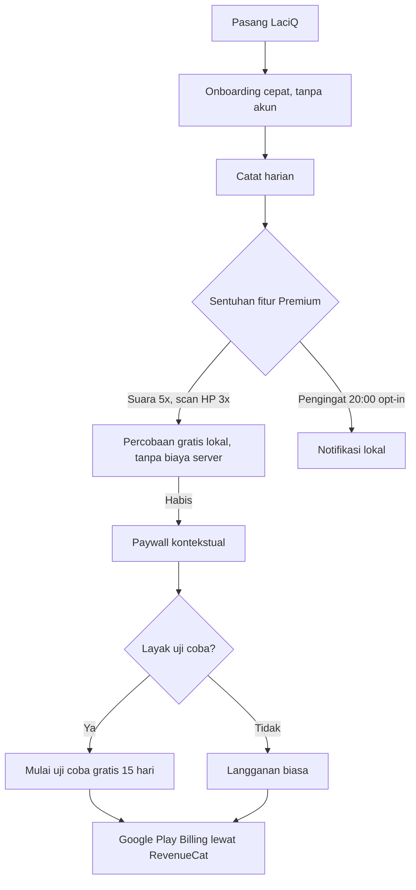

# Rencana Implementasi dan Optimasi LaciQ (`com.hardanti.lacipintar`), Versi 2

> **Versi 2, diperbarui 2026-10-09 setelah memeriksa Play Console.** Menggantikan versi 1 (tersimpan di git, commit `1d5711e`). Perubahan utama dari versi 1 ada di bagian
> 8. Rencana ini sudah diselaraskan dengan `docs/RENCANA-RILIS-BERIKUTNYA.md` (satu rilis berikutnya memuat CMP/UMP, sapaan "kamu",
> dan butir kode di sini) dan dengan batasan kebijakan Google Play.

**Tujuan:** menambah pengguna baru dan menaikkan konversi ke langganan berbayar, tanpa menambah biaya server yang tak terkendali
dan tanpa melanggar kebijakan Play.

**Prinsip:**
1. Satu rilis aplikasi = satu peninjauan Play. Gabungkan perubahan kode.
2. Hanya klaim yang benar untuk paket yang dilihat pengguna (jangan menjanjikan fitur Ultimate di halaman yang dibaca pengguna gratis).
3. Tidak ada biaya variabel (AI) untuk pengguna yang belum membayar, kecuali dengan batas di sisi server.
4. Ukur dulu, baru ubah lagi. Satu perubahan besar per periode ukur.

## 0. Kondisi saat ini (fakta per 2026-10-09)
| Hal | Kondisi |
|---|---|
| Versi produksi | 1.0.0 (14), tayang sejak 2026-10-07 |
| Judul listing | `LaciQ: Catatan Keuangan Harian` (30 karakter), **tayang** (diterapkan pemilik 2026-10-08) |
| Deskripsi singkat | `Catat keuangan harian praktis tanpa login. Scan struk AI & laporan rapi.` (72 dari 80), **tayang** (2026-10-08) |
| Screenshot ponsel | 7 sudah terpasang (maks. Play: 8), termasuk 4 screenshot Ultimate bercaption |
| Paket dan harga | Gratis; Premium Rp7.500/bln atau Rp75.000/thn; Ultimate Rp12.500/bln atau Rp125.000/thn |
| Produk Play | `dompetku_premium`, `dompetku_ultimate`, masing-masing base plan `monthly` dan `yearly` (ID produk tetap walau nama berubah) |
| Penagihan | RevenueCat (`purchases_flutter`), paywall di `lib/features/subscription/` |
| Penawaran uji coba | **Sudah aktif** (2026-10-08): `trial-15d-tahunan` pada `yearly` di `dompetku_premium` **dan** `dompetku_ultimate`; kelayakan pelanggan baru, belum pernah berlangganan produk itu; hanya Indonesia; fase uji coba gratis 15 hari |
| Ulasan dalam aplikasi | Sudah ada (`in_app_review`), dimunculkan setelah 10 transaksi (`review_prompt_service.dart`) |
| Notifikasi lokal | Ada untuk Agenda (`flutter_local_notifications`, `zonedSchedule`); belum ada pengingat harian |
| Iklan | Paket gratis menampilkan banner AdMob setelah masa tenggang iklan 30 hari sejak pemakaian pertama |
| Masa tenggang pembayaran | **Sudah diatur** (diperiksa 2026-10-09): `monthly` 7 hari (penangguhan akun 53 hari), `yearly` 14 hari (penangguhan 46 hari), keduanya di Premium dan Ultimate |
| RevenueCat (diperiksa 2026-10-09) | Kredensial akun layanan valid; empat produk Play terbit dan terhubung ke entitlement (Ultimate = 2 entitlement); offering `dompetku` berisi 4 paket yang benar. **Notifikasi pengembang Google (RTDN) BELUM tersambung** (tombol "Connect to Google" nonaktif, daftar topik kosong). Offering `default` lama (3 paket) masih ada |
| Peninjauan AdMob | Aplikasi terverifikasi 2026-10-08, menunggu persetujuan (2-3 hari) |
| Fitur per paket | Suara, scan struk di HP, Laporan Bulanan, Excel = Premium. Scan struk AI, ringkasan AI, multi buku kas = Ultimate |

> **Istilah:** "masa tenggang iklan" (30 hari tanpa iklan bagi pengguna baru) berbeda dari **masa tenggang pembayaran** (grace period
> penagihan Play, bagian 1.1). Jangan tertukar di dokumen maupun di aplikasi.

---

## Bagian 1: Play Console (tanpa ubah kode aplikasi)
Dikerjakan bertahap. Perubahan listing memicu peninjauan lagi; penawaran langganan tidak.

### 1.1 Masa tenggang pembayaran (grace period): SELESAI
* **Status 2026-10-09:** sudah diatur di keempat paket dasar (bulanan 7 hari, tahunan 14 hari, penangguhan akun otomatis). Nilainya
  mengikuti anjuran Google per periode; **tidak perlu diubah**. Yang tersisa hanya memastikan RevenueCat memberi akses selama masa
  tenggang (di bawah).
* **Lokasi:** Play Console > Monetisasi > Produk > Langganan > `dompetku_premium` dan `dompetku_ultimate` > base plan `monthly` dan
  `yearly`, bagian pemulihan pembayaran yang gagal (masa tenggang dan penahanan akun). Nama menu dapat berubah; cari setelan itu.
* **Periksa di RevenueCat:** akses entitlement tetap aktif selama masa tenggang (pengaturan Google Play di proyek RevenueCat), dan
  aplikasi tidak langsung menurunkan pengguna ke Gratis.
* **Manfaat:** pembayaran gagal (saldo e-wallet, kartu) tidak langsung memutus langganan.

### 1.2 Penawaran "uji coba gratis 15 hari" pada paket tahunan: SELESAI
* **Status 2026-10-09:** `trial-15d-tahunan` aktif di Premium **dan** Ultimate tahunan (lebih cepat dari rencana yang menunda Ultimate).
  Karena Ultimate trial memakai kuota AI berbiaya, **pantau pemakaian dan biayanya**; jangan menambah penawaran lain sebelum ada data.
* Parameter yang berlaku (untuk referensi):
* **Lokasi:** Monetisasi > Produk > Langganan > pilih langganan > base plan `yearly` > Tambahkan penawaran.
  1. Offer ID: `trial-15d-tahunan`
  2. Kelayakan: **pelanggan baru** (belum pernah berlangganan produk ini)
  3. Fase penagihan: **uji coba gratis**, 15 hari, lalu harga normal tahunan
  4. Simpan dan aktifkan
* **Pastikan di RevenueCat** bahwa penawaran terpilih otomatis untuk pembeli yang memenuhi syarat dan paywall di aplikasi tetap
  menampilkan paket yang benar. Uji dengan akun *license tester* (pembelian uji kedaluwarsa jauh lebih cepat dari 15 hari).
* **Mengapa tahunan:** tagihan pertamanya paling besar, jadi uji coba paling menurunkan keraguan. Ini **hipotesis**; evaluasi
  *trial-to-paid* sebelum memperluas.
* **Catatan biaya (dari `docs/PROYEKSI-FINANSIAL.md`):** trial menunda penerimaan 15 hari dan, untuk Ultimate, bisa memakai kuota
  AI penuh (maks. kira-kira Rp1.400 untuk 300 scan + Rp900 untuk 30 ringkasan per pengguna). Jangan menghitung pelanggan trial
  sebagai pendapatan.
* **Satu pengguna dapat dua trial** bila mencoba Premium lalu Ultimate (dua produk berbeda). Dapat diterima, tetapi pantau.
* **Sebelum aplikasi menampilkan teks trial** (bagian 2.1), lembar pembayaran Google Play sudah menampilkan syarat trial. Itu cukup
  untuk kepatuhan; teks di aplikasi menambah konversi.

### 1.5 Notifikasi pengembang real-time (RTDN) ke RevenueCat: BELUM
* Tanpa RTDN, RevenueCat baru tahu perubahan langganan (mulai trial, konversi trial ke berbayar, pembatalan, masa tenggang, penangguhan,
  pengembalian dana) lewat sinkron berkala atau saat aplikasi dibuka, jadi data dan status bisa terlambat. RevenueCat sendiri "sangat
  menyarankan" menyambungkannya. Ini terutama penting sekarang karena trial 15 hari aktif.
* **Langkah:** (1) Google Cloud: aktifkan Cloud Pub/Sub API di proyek yang sama dengan akun layanan; beri akun layanan peran yang
  mengizinkan membuat/mengelola topik (Pub/Sub Admin) dan izin yang diminta RevenueCat. (2) RevenueCat > Apps > DompetKu (Play Store) >
  Google developer notifications: pilih/buat topik lalu *Connect to Google*. (3) Play Console > Monetisasi > Penyiapan monetisasi:
  pastikan topik tercatat dan kirim notifikasi uji. (4) Verifikasi: transaksi uji muncul di RevenueCat tanpa membuka aplikasi.
* Perlu hak akses ke Google Cloud IAM; dikerjakan pemilik atau dengan persetujuannya.

### 1.3 Listing: pertahankan judul, uji deskripsi singkat
* **Judul `LaciQ: Catatan Keuangan Harian` sudah tayang.** Jangan diubah lagi sekarang. Ukur dulu dampaknya 4 minggu (Statistik >
  Akuisisi dan kata kunci pencarian) sebelum memutuskan apa pun.
* **Deskripsi singkat yang tayang** menyebut "Scan struk AI", padahal AI hanya Ultimate; pengunjung gratis bisa mengira AI gratis.
  Kandidat pengganti yang hanya berisi fitur yang benar untuk semua pengunjung (tidak menyebut AI), bila eksperimen mendukung:
  `Catat uang tanpa akun. Suara, scan struk, anggaran, dan laporan bulanan.` (72 karakter)
  Bandingkan dengan versi sekarang lewat **eksperimen listing Play** bila tersedia untuk deskripsi singkat (verifikasi di Console).
  Samakan sapaan dengan rencana "kamu" (hindari kata "Anda" di teks baru).
* **Screenshot:** sudah dikurasi (7 dari maks. 8, tiga pertama bercaption). **Tidak ada tindakan** kecuali menambah satu
  screenshot Laporan Bulanan atau Catat dengan Suara; ganti hanya satu per periode ukur.

### 1.4 Modal sosial awal (tanpa melanggar kebijakan)
* **Dilarang:** meminta atau menjanjikan ulasan bintang lima, memberi imbalan untuk ulasan, atau memanipulasi peringkat (kebijakan
  Play). Ini juga berlaku bagi teman dan komunitas.
* **Boleh:** mengajak 15-20 orang memasang, mencoba 2 minggu, dan **memberi masukan jujur** lewat email atau ulasan jika mereka mau.
  Dialog ulasan dalam aplikasi sudah muncul otomatis di waktu yang tepat.
* Teks ajakan dan materi ada di `promosi/PAKET-KONTEN.md` dan `docs/PROMOSI-PEMASARAN.md`.

---

## Bagian 2: Perubahan kode (satu rilis, digabung dengan CMP dan "kamu")
Aplikasi ini **Flutter**. Gunakan paket yang sudah dipakai (`purchases_flutter`, `flutter_local_notifications`, `in_app_review`),
bukan API native Android.

### 2.1 Paywall yang menampilkan uji coba
* Ambil detail dari paket RevenueCat (`Package.storeProduct`, termasuk opsi berlangganan yang memuat fase uji coba). Tampilkan
  teks uji coba **hanya bila penawaran berlaku untuk pengguna itu** (pelanggan baru).
* CTA saat layak: **"Mulai uji coba gratis 15 hari"**. Teks tepat di bawah tombol: *"Gratis 15 hari, lalu Rp75.000/tahun
  (Premium). Perpanjang otomatis. Batalkan kapan saja di Google Play."* Gunakan harga hasil `priceString` yang sebenarnya,
  jangan menulis angka tetap di kode.
* CTA saat tidak layak: tetap tombol langganan biasa. Jangan menjanjikan trial pada pengguna yang sudah memakainya.
* Tes widget: dengan paket palsu yang punya fase uji coba dan yang tidak punya.

### 2.2 Percobaan gratis fitur yang berjalan di HP (bukan AI)
* **Kendala v1:** fitur Premium (Catat dengan Suara dan scan struk di HP) tidak bisa dicoba pengguna gratis. Keduanya berjalan di HP
  (tanpa biaya server), jadi aman diberi percobaan terbatas.
* **Implementasi:** counter lokal di penyimpanan pengaturan yang sudah ada: suara 5x, scan struk di HP 3x. Saat habis, tampilkan
  lembar bawah (*bottom sheet*): *"Kamu sudah memakai 5 percobaan suara. Suka? Premium membukanya tanpa batas (Coba gratis 15 hari)."*
  Counter lokal bisa direset dengan menghapus data aplikasi; itu dapat diterima karena tidak ada biaya variabel.
* **Dampak dokumen:** perbarui `docs/MATRIKS-FITUR-PAKET.md`, kartu fitur dan paket di situs, deskripsi Play, dan layar
  langganan (jangan sampai Gratis tertulis "tidak ada suara").
* **Tidak dilakukan: kuota gratis untuk scan AI dan ringkasan AI.** Setiap panggilan biaya nyata (≈Rp4,6 per scan, ≈Rp30 per
  ringkasan), Worker hanya melayani Ultimate (`403 not_ultimate`), dan counter lokal tidak bisa membatasi penyalahgunaan. Bila
  kelak diperlukan: batasi di **sisi server** (kuota per ID anonim ditambah batas harian global dan anggaran bulanan), ubah
  Worker, kebijakan privasi, situs ("Server AI hanya Ultimate"), dan Data Safety.

### 2.3 Pengingat harian (opt-in)
* Gunakan `flutter_local_notifications` (`zonedSchedule`, pengulangan harian), **bukan WorkManager**. Penjadwalan tidak tepat
  (inexact) cukup; hindari izin alarm tepat.
* Default **mati**. Tawarkan saat onboarding atau setelah transaksi ketiga, jangan saat pertama dibuka. Sakelar dan pemilih jam
  (bawaan 20:00 WIB) di Pengaturan.
* Teks: *"Sudah catat pengeluaran hari ini? Butuh 10 detik di LaciQ."* Hentikan atau tunda bila pengguna mencatat hari itu.
* Periksa: izin `POST_NOTIFICATIONS` (Android 13+; sudah dideklarasikan), penjadwalan ulang setelah HP dihidupkan ulang (periksa
  manifest gabungan), dan hemat baterai (merek seperti Xiaomi dapat menunda notifikasi).

### 2.4 App Shortcuts (pengganti widget)
* Paket `quick_actions`: tekan lama ikon aplikasi untuk **"+ Pengeluaran"** dan **"Scan Struk"**. Usaha jauh lebih kecil daripada
  widget dan tetap mengurangi gesekan mencatat.
* Pintasan "Scan Struk" mengikuti hak paket (membuka paywall bila belum berhak).

### 2.5 Ulasan dalam aplikasi: tidak diubah
* Sudah ada, ambang 10 transaksi. Jangan diturunkan ke 5: ambang lebih rendah menurunkan kualitas rating dan Play membatasi
  frekuensi dialog. Tinjau setelah ada data rating.

### 2.6 Dibawa dalam rilis yang sama
* **CMP/UMP AdMob** dan **sapaan "kamu"**: lihat `docs/RENCANA-RILIS-BERIKUTNYA.md`. Teks baru di bagian ini (paywall, lembar
  percobaan, pengingat) sudah memakai "kamu".

### 2.7 Ditunda
* **Widget layar utama.** Perlu kode native Android di aplikasi Flutter dan permukaan uji tambahan. Ambil kembali bila App
  Shortcuts terbukti dipakai.

---

## Bagian 3: Dokumen dan materi yang ikut berubah
| Berkas | Perubahan |
|---|---|
| `docs/MATRIKS-FITUR-PAKET.md` | Percobaan gratis suara dan scan HP; penawaran uji coba |
| `docs/LISTING-PLAY-STORE.md` | Deskripsi singkat baru bila lolos eksperimen; teks uji coba |
| `docs/PROYEKSI-FINANSIAL.md` dan `.xlsx` | Tambah asumsi: persentase mulai uji coba, trial-to-paid, biaya AI trial, penundaan pendapatan 15 hari |
| `docs/DATA-SAFETY-PLAY.md` | Cek ulang; tidak ada data baru diharapkan (counter lokal, notifikasi lokal) |
| `docs/kebijakan-privasi/index.html` | Hanya bila AI dibuka untuk pengguna gratis (tidak direncanakan) |
| `docs/situs-beranda/index.html` | Kartu paket (uji coba 15 hari) dan percobaan gratis, setelah rilis tayang |
| `promosi/*` | Sebut uji coba hanya setelah penawarannya aktif |

---

## Bagian 4: Risiko dan kepatuhan Play
| Risiko | Mitigasi |
|---|---|
| Ulasan atau peringkat dimanipulasi (kebijakan Play) | Tidak meminta bintang lima; hanya meminta masukan jujur |
| Syarat uji coba kurang jelas | Teks harga, masa uji, perpanjangan otomatis, dan cara membatalkan di dekat tombol; lembar pembayaran Play menampilkan syarat resmi |
| Pengguna merasa ditagih tanpa sadar | Tombol hanya menjanjikan trial pada yang layak; tautan "Kelola langganan" jelas di Pengaturan |
| Biaya AI tak terkendali | Tidak ada kuota AI gratis; kuota Ultimate 300 scan dan 30 ringkasan per bulan (batas harian 15 dan 5) tetap |
| Notifikasi dianggap mengganggu | Opt-in, bisa dimatikan, tidak muncul bila sudah mencatat |
| Fitur Premium terlihat "bocor" | Percobaan terbatas dan hanya fitur di HP |
| Peninjauan berkali-kali | Satu rilis aplikasi, perubahan listing dikelompokkan |
| Dua trial per pengguna | Pantau jumlah pelanggan dengan trial ganda |

---

## Bagian 5: Metrik dan keputusan
Catat di Play Console (Statistik) dan RevenueCat. Baseline diambil dari 14 hari pertama setelah 2026-10-07.

| Metrik | Sumber | Pemakaian |
|---|---|---|
| Pemasangan dan sumber (utm referrer) | Play Console | Efek promosi |
| Konversi listing (kunjungan ke pasang) | Play Console | Efek eksperimen deskripsi |
| Retensi hari-1, 7, 30 | Play Console | Efek pengingat dan shortcut |
| Mulai uji coba, trial-to-paid, pemakaian kuota AI selama trial Ultimate | RevenueCat, log Worker | Mengubah atau menghentikan trial |
| Pelanggan berbayar per pemasangan aktif | RevenueCat | Target proyeksi (1-3%) |
| Rating dan jumlah ulasan | Play Console | Kualitas, bukan jumlah |
| Persentase opt-in pengingat | Analitik lokal tidak ada; ukur dengan survei kecil atau retensi | Ubah posisi tawaran |

**Aturan keputusan (awal, sesuaikan dengan data):**
* Pertahankan trial Ultimate bila trial-to-paid ≥ 30% dengan minimal 30 trial yang selesai dan biaya AI per trial wajar (< Rp2.300).
* Tinjau ulang judul bila pencarian merek tinggi tetapi pencarian kata kunci rendah selama 4 minggu.
* Hentikan atau ubah trial bila trial-to-paid < 15% dan biaya dukungan naik.

---

## Bagian 6: Matriks prioritas dan jadwal
| Fase | Waktu | Pekerjaan | Syarat |
|---|---|---|---|
| **0. Selesai** | 2026-10-08 | Grace period, trial 15 hari (Premium dan Ultimate tahunan), judul dan deskripsi singkat baru sudah diterapkan pemilik; sisa: **sambungkan RTDN di RevenueCat** (lihat bagian 1.5), uji pembelian trial dengan license tester, dan cek akses saat masa tenggang | Tidak perlu rilis aplikasi |
| **1. Pengamatan** | Minggu 1-2 | Promosi sosial sesuai `promosi/`; ajak 15-20 orang memberi masukan jujur; kumpulkan baseline | Hindari perubahan listing selama peninjauan AdMob |
| **2. Eksperimen listing** | Minggu 2-4 | Uji deskripsi singkat baru lewat eksperimen listing | Data cukup (minimal beberapa ratus kunjungan) |
| **3. Rilis v1.1** | Minggu 3-5 | Paywall trial, percobaan gratis (suara, scan HP), pengingat harian opt-in, App Shortcuts, CMP/UMP, sapaan "kamu"; satu build, satu peninjauan | AdMob selesai ditinjau; tes lulus; Data Safety dicek |
| **4. Evaluasi** | Bulan 1-2 | Tinjau metrik bagian 5; putuskan ekspansi trial ke Ultimate, judul, widget | Data riil |

## Bagian 7: Daftar tes sebelum rilis v1.1
* Widget paywall dengan paket bertrial dan tanpa trial; harga dari RevenueCat.
* Counter percobaan: tidak mengurangi bila fitur gagal; muncul lembar saat habis; tidak menyentuh fitur AI.
* Pengingat: terjadwal, tidak muncul bila sudah mencatat, pulih setelah reboot, mati saat sakelar dimatikan.
* Shortcut: membuka form atau kamera; paywall bila belum berhak.
* UMP: alur persetujuan EEA (geografi debug), tidak ada iklan sebelum persetujuan.
* Seluruh suite (`flutter test`), uji pembelian dengan license tester di HP nyata (pembelian trial, pembatalan, pemulihan).

## Bagian 8: Perubahan dari versi 1
| # | Versi 1 | Versi 2 |
|---|---|---|
| 1 | Minta pengguna "beri review bintang 5" | Dihapus (melanggar kebijakan); diganti minta masukan jujur |
| 2 | Kode ditulis untuk Android native (`BillingClient`, `DataStore`, `WorkManager`, Gradle) | Disesuaikan dengan Flutter, RevenueCat, `flutter_local_notifications`, `quick_actions` |
| 3 | In-App Review "ditambahkan", ambang 5 | Sudah ada, ambang 10 dipertahankan |
| 4 | Kurasi 22 screenshot | Sudah selesai (7, maks. 8); tidak ada tindakan |
| 5 | Judul diganti ke `... Harian`; deskripsi singkat menyebut "Scan struk AI" | Sudah diterapkan pemilik; judul dipertahankan dan diukur; deskripsi dikaji ulang lewat eksperimen karena menyebut AI |
| 6 | Kuota gratis scan AI dan suara (Ultimate terkunci) dengan counter lokal | Hanya fitur HP (suara, scan OCR) yang diberi percobaan; AI tidak digratiskan (biaya dan penyalahgunaan) |
| 7 | Trial pada Premium dan Ultimate sekaligus | Sudah diterapkan pada keduanya (2026-10-08); pantau biaya AI Ultimate |
| 8 | Pengingat harian default aktif | Opt-in, dengan pilihan jam |
| 9 | Widget layar utama | Ditunda; diganti App Shortcuts |
| 10 | Rilis v1.1 berdiri sendiri | Digabung dengan CMP/UMP dan sapaan "kamu" |
| 11 | Tanpa metrik, aturan keputusan, dan tes | Ada bagian 5-7 |
