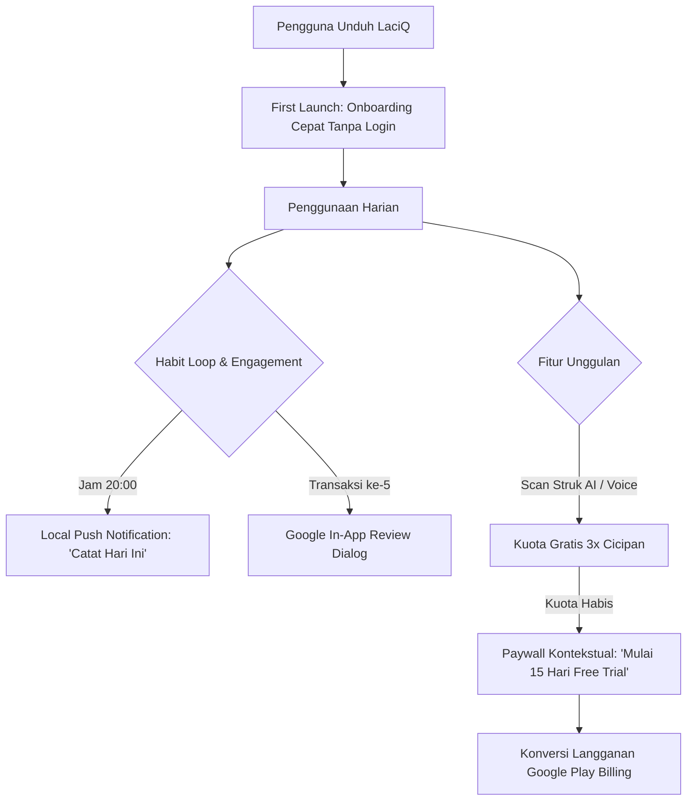

# Rencana Implementasi & Optimasi LaciQ (`com.hardanti.lacipintar`)

Dokumen ini memuat peta jalan (*action plan*) untuk mendongkrak **basis pengguna baru** dan **konversi pelanggan aktif berbayar** untuk LaciQ. Rencana dibagi menjadi dua bagian: perbaikan langsung di Google Play Console (tanpa sentuh kode) dan penyempurnaan di sisi *source code* Android.

---

## Bagian 1: Perbaikan di Google Play Console (Tanpa Ubah Source Code)

Perubahan ini dapat langsung diterapkan hari ini di dasbor Play Console tanpa perlu melakukan *build* atau *upload* APK/AAB baru.

### 1. Update Judul Aplikasi & Deskripsi Singkat (ASO)
* **Lokasi Console:** `Kembangkan basis pengguna (Grow)` > `Kehadiran di Store` > `Listingan Play Store default` > `Edit`.
* **Judul Baru (Maks 30 Karakter):**
  * **Rekomendasi Utama:** `LaciQ: Catatan Keuangan Harian` (29 karakter)
  * *Alternatif:* `LaciQ: Catatan Keuangan & Kas` (28 karakter)
  * *Alasan:* Kata kunci "keuangan harian" dan "kas" memiliki volume pencarian organik tertinggi di Play Store Indonesia.
* **Deskripsi Singkat Baru (Maks 80 Karakter):**
  * **Teks:** `Catat keuangan harian praktis tanpa login. Scan struk AI & laporan rapi.` (74 karakter)
  * *Alasan:* Langsung mengomunikasikan 3 keunggulan utama: tanpa login, ada AI, dan rapi.

---

### 2. Penambahan Penawaran "15 Hari Free Trial"
* **Lokasi Console:** `Monetisasi (Monetize)` > `Produk` > `Langganan` > Pilih langganan > `Tambahkan penawaran (Add offer)`.

#### Rekomendasi Alokasi Paket:
Disarankan memasang penawaran ini pada paket **Tahunan** (`yearly`) untuk **DompetKu Premium** dan **DompetKu Ultimate**. 
> [!TIP]
> **Mengapa Paket Tahunan?**
> Jika 15 hari gratis diberikan pada paket bulanan (30 hari), pengguna mendapatkan separuh periode gratis dan sering membatalkan langganan sebelum hari ke-15. Pada paket tahunan, free trial 15 hari memberikan rasa aman tanpa risiko, dan rasio konversi menjadi pelanggan berbayar setahun penuh jauh lebih tinggi.

#### Parameter Konfigurasi di Play Console:
1. **Pilih Paket Dasar:** `yearly` (Tahunan)
2. **ID Penawaran (Offer ID):** `trial-15d-tahunan`
3. **Kelayakan Klien (Eligibility):**
   * Pilih: *Akuisisi pelanggan baru (New customer acquisition)*.
   * Syarat: *Pengguna yang belum pernah memiliki langganan ini sebelumnya*.
4. **Fase Penagihan (Billing phase):**
   * Klik *Tambahkan fase* > Pilih jenis: **Uji coba gratis (Free trial)**.
   * Durasi: **15 hari** (atau ketik `15` dengan satuan `hari`).
5. **Simpan dan Aktifkan (Save & Activate).**
6. *Ulangi langkah yang sama untuk paket tahunan pada `dompetku_ultimate`.*

---

### 3. Pengaturan Masa Tenggang (Grace Period)
* **Lokasi Console:** Masuk ke paket dasar `monthly` dan `yearly` di `dompetku_premium` dan `dompetku_ultimate`.
* **Tindakan:** Aktifkan **Masa Tenggang (Grace Period) = 7 hari** (saat ini belum tersetel/kosong).
* *Manfaat:* Jika saldo e-wallet atau kartu pengguna gagal terdebit di tanggal perpanjangan, langganan tidak langsung putus. Google Play memberi waktu 7 hari bagi pengguna untuk memperbarui pembayaran.

---

### 4. Kurasi dan Penataan Ulang Screenshot (Listing CVR)
* **Kondisi Saat ini:** Terdapat 22 screenshot (terlalu banyak dan pengguna cenderung tidak melihat semuanya).
* **Tindakan:** 
  1. Sisakan **5–7 screenshot paling esensial**.
  2. Pastikan 3 screenshot pertama memiliki *header text* yang jelas dan kontras:
     * **Slide 1:** "Catat Keuangan Praktis Tanpa Login"
     * **Slide 2:** "Scan Struk Otomatis dengan AI"
     * **Slide 3:** "Multi Buku Kas Pribadi & Bisnis"

---

## Bagian 2: Perbaikan yang Memerlukan Modifikasi Source Code Aplikasi

Perubahan ini dimasukkan ke dalam update rilis aplikasi berikutnya (misal v1.1.0) untuk memaksimalkan retensi dan aktivasi langganan.

---

### 1. Penyesuaian UI Paywall untuk Mendukung Free Trial
* **Kendala Saat Ini:** Jika aplikasi hanya menampilkan tombol *"Langganan Rp 125.000/thn"*, calon pengguna merasa langsung ditagih.
* **Perubahan Kode:**
  * Ambil detail penawaran (*offer details*) dari `BillingClient` (`ProductDetails.SubscriptionOfferDetails`).
  * Jika offer `trial-15d` aktif, ubah teks tombol CTA utama menjadi:
    > **"Mulai Uji Coba Gratis 15 Hari"**
  * Tampilkan teks kepatuhan di bawah tombol:
    > *"Rp 0 untuk 15 hari pertama, lalu Rp 125.000/tahun. Batalkan kapan saja di Google Play Store."*

---

### 2. Implementasi Sistem Kuota Gratis Awal (Freemium Quota)
* **Kendala Saat Ini:** Fitur Ultimate (Scan Struk AI & Catat Suara) langsung terkunci di paket gratis, sehingga pengguna gratis tidak mengetahui keandalannya.
* **Perubahan Kode:**
  * Simpan counter lokal di `SharedPreferences` / `DataStore`:
    * `ai_receipt_free_trial_count` (misal default: 3 kali).
    * `voice_input_free_trial_count` (misal default: 5 kali).
  * Izinkan pengguna gratis mencoba scan struk AI hingga kuota habis.
  * Ketika kuota mencapai 0, munculkan *Modal BottomSheet*:
    > *"Anda telah menggunakan 3 scan struk gratis. Suka kemudahan scan otomatis? Dapatkan hingga 300 scan/bulan dengan LaciQ Ultimate (Coba Gratis 15 Hari)."*

---

### 3. Pengingat Harian Otomatis (Local Notification)
* **Tujuan:** Mencegah churn pengguna di hari ke-3 sampai ke-7 (*habit building*).
* **Perubahan Kode:**
  * Gunakan `WorkManager` dengan `PeriodicWorkRequestBuilder` atau `AlarmManager`.
  * Jadwalkan notifikasi lokal setiap pukul **20:00 WIB**:
    * Judul: *"Catatan Keuangan Hari Ini"*
    * Pesan: *"Sudah catat pengeluaran hari ini? Cuma butuh 10 detik di LaciQ."*
  * Buat opsi sakelar (toggle ON/OFF) dan ubah jam pengingat di menu **Pengaturan Aplikasi**.

---

### 4. Pemicu Ulasan Otomatis (Google Play In-App Review API)
* **Tujuan:** Mendapatkan ulasan bintang 5 organik secara konsisten tanpa memaksa pengguna keluar dari aplikasi.
* **Perubahan Kode:**
  * Tambahkan dependensi: `implementation("com.google.android.play:review:2.0.2")` (atau versi terbaru).
  * Simpan counter jumlah transaksi yang berhasil dicatat.
  * Pemicu: Begitu pengguna mencatat **transaksi ke-5 atau ke-10**, panggil `ReviewManager.requestReviewFlow()`.
  * *Catatan:* Jangan pernah memicu dialog review saat aplikasi baru dibuka atau saat pengguna mengalami error.

---

### 5. Widget Layar Utama (Home Screen Quick Actions)
* **Tujuan:** Mengurangi friksi mencatat pengeluaran harian.
* **Perubahan Kode:**
  * Buat App Widget sederhana (ukuran 4x1 atau 2x1) dengan 2 tombol instan:
    1. Tombol `+ Pengeluaran` (langsung membuka form pengeluaran).
    2. Tombol `Scan Struk` (langsung membuka kamera pemindai).

---

## Matriks Prioritas & Jadwal Eksekusi

| Fase | Fokus | Pekerjaan Utama | Dampak |
|---|---|---|---|
| **Fase 1 (Hari 1 - 2)** | Play Console (Tanpa Kode) | 1. Update Judul ke `LaciQ: Catatan Keuangan Harian` 2. Pasang Offer 15 Hari Free Trial di paket tahunan 3. Set Grace Period 7 hari 4. Rapikan 6 screenshot terbaik | Membuka indexing pencarian & menghilangkan hambatan pembayaran awal |
| **Fase 2 (Minggu 1)** | Social Proof Awal | Ajak 15–20 pengguna/komunitas mengunduh via pencarian Play Store & beri review bintang 5 | Membuka visibilitas algoritma Play Store |
| **Fase 3 (Minggu 2)** | Rilis Update v1.1 (Source Code) | 1. Update UI Paywall (Tombol Free Trial) 2. Kuota gratis 3x Scan Struk AI 3. Local notification pengingat jam 20:00 4. In-App Review API di transaksi ke-5 | Meningkatkan D7/D30 retention dan konversi ke langganan aktif |
| **Fase 4 (Bulan 1)** | Evaluasi Data Console | Cek metrik *Store listing conversion*, *Drop-off rate*, dan konversi trial-to-paid | Iterasi lanjutan berdasarkan data riil |
